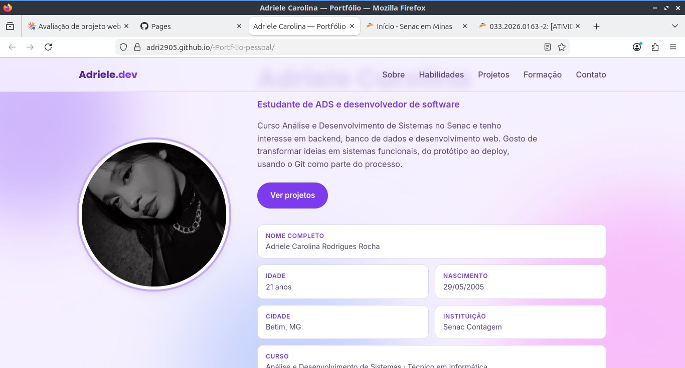
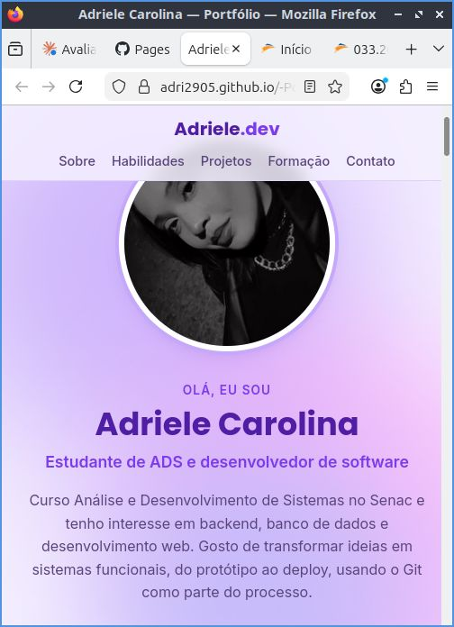

# Portfólio Pessoal — Adriele Carolina

Portfólio pessoal desenvolvido para a atividade **Portfólio Pessoal com CSS Grid e Flexbox**, do curso superior de Análise e Desenvolvimento de Sistemas (ADS) do Senac.

## Identificação

| | |
|---|---|
| **Aluna** | Adriele Carolina Rodrigues Rocha |
| **Curso** | Análise e Desenvolvimento de Sistemas (ADS) — Senac Contagem |
| **Turma** | 033.2026.0163 |
| **Atividade** | Portfólio Pessoal com CSS Grid e Flexbox (15 pontos) |

## Links

- **Site publicado (GitHub Pages):** https://adri2905.github.io/-Portf-lio-pessoal/
- **Repositório:** https://github.com/Adri2905/-Portf-lio-pessoal

## Prints

### Desktop


### Mobile


## Seções do site

O menu de navegação leva a cada seção por âncora (`#id`):

1. **Sobre** (`#sobre`) — foto, apresentação, nome completo, idade (calculada automaticamente), nascimento, cidade, instituição e curso.
2. **Habilidades** (`#habilidades`) — cards de Linguagens, Web, Banco de dados e Ferramentas.
3. **Projetos** (`#projetos`) — cards com Universidade, Nexus Imports, Carbono Consciente e Concessionária, cada um com tecnologias e link para o GitHub.
4. **Formação e experiência** (`#formacao`) — ADS, Técnico em Informática e projetos acadêmicos e pessoais.
5. **Contato** (`#contato`) — links de e-mail, GitHub e LinkedIn.
6. **Rodapé** — direitos, links rápidos e botão de voltar ao topo.

## Onde usei CSS Grid

| Seção | Seletor | O que faz |
|---|---|---|
| Sobre | `.about` | Duas colunas (`300px 1fr`) com `grid-template-areas` para foto, texto e informações |
| Sobre | `.about__info` | Grade de 2 colunas com `repeat(2, 1fr)`; itens largos usam `grid-column: span 2` |
| Habilidades | `.skills` | `repeat(4, 1fr)` com `gap: 20px` |
| Projetos | `.projects` | `repeat(3, 1fr)` com `gap: 24px` |
| Formação | `.timeline` | `repeat(3, 1fr)` com `gap: 20px` |

## Onde usei Flexbox

| Local | Seletor | O que faz |
|---|---|---|
| Menu | `.nav`, `.nav__links` | Logo à esquerda e links à direita (`justify-content: space-between`, `align-items: center`) |
| Tags | `.tags` | Distribui as tecnologias com `flex-wrap` e `gap` |
| Cards de projeto | `.project-card`, `.project-card__body`, `.project-card__cover` | Conteúdo em coluna; botão alinhado ao final com `flex-grow`; capa centralizada |
| Contato | `.contact`, `.contact__link` | Botões em linha com `flex-wrap`, `flex: 1 1 200px` e conteúdo centralizado |
| Rodapé | `.footer__inner`, `.footer__links` | Texto e links distribuídos com `justify-content: space-between` |

## Responsividade

O site usa abordagem com dois breakpoints:

- **Desktop (acima de 900px):** layout completo com 3 e 4 colunas.
- **Tablet (até 900px):** habilidades e projetos em 2 colunas; formação em 1 coluna; seção Sobre empilhada e centralizada.
- **Celular (até 600px):** tudo em 1 coluna; menu empilhado com links quebrando linha; contato e rodapé em coluna.

Também uso `clamp()` no título principal e `scroll-padding-top` para o menu fixo não cobrir os títulos ao navegar.

## HTML semântico e acessibilidade

- `lang="pt-BR"` definido no `<html>`.
- Tags semânticas: `header`, `nav`, `main`, `section`, `article`, `footer` e `time`.
- Hierarquia de títulos: um único `h1` (nome), `h2` por seção e `h3` nos cards.
- Texto alternativo (`alt`) na imagem de perfil; elementos puramente decorativos usam `aria-hidden="true"`.
- `aria-label` no menu de navegação e `:focus-visible` nos links.
- Respeito a `prefers-reduced-motion`, que desliga animações para quem prefere.

## Identidade visual

Paleta em tons de roxo, definida a partir de uma única variável de matiz (`--h`) em `:root`, o que mantém as cores harmônicas. Tipografia com **Poppins** nos títulos e **Inter** no texto, vindas do Google Fonts, com fontes de reserva (Arial). Raios, sombras e largura máxima também estão em variáveis CSS.

## Estrutura de pastas

```
-Portf-lio-pessoal/
├── .github/workflows/   # publicação no GitHub Pages
├── img/                 # imagens do site (foto de perfil)
├── prints/              # prints de desktop e mobile usados neste README
├── index.html           # estrutura da página
├── style.css            # estilos (CSS externo, variáveis, Grid e Flexbox)
├── script.js            # comportamentos em JavaScript
└── README.md
```

## Tecnologias

HTML5, CSS3 (Grid, Flexbox, variáveis, media queries) e JavaScript, publicado com GitHub Pages.

## Como executar localmente

```bash
git clone https://github.com/Adri2905/-Portf-lio-pessoal.git
cd -Portf-lio-pessoal
```

Depois, abra o arquivo `index.html` no navegador.

## Uso de Inteligência Artificial

Declaro que utilizei ferramentas de IA (Claude, da Anthropic) como **apoio**: para tirar dúvidas, revisar o código e ajudar a organizar este README. Sei explicar qualquer trecho do código do projeto caso seja solicitado.

## Autora

**Adriele Carolina Rodrigues Rocha**  
[GitHub](https://github.com/Adri2905) · [LinkedIn](https://www.linkedin.com/in/adriele-carolina-4503bb400)
